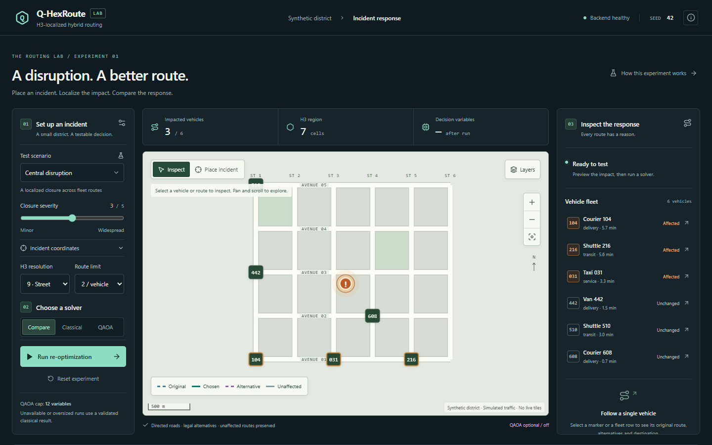
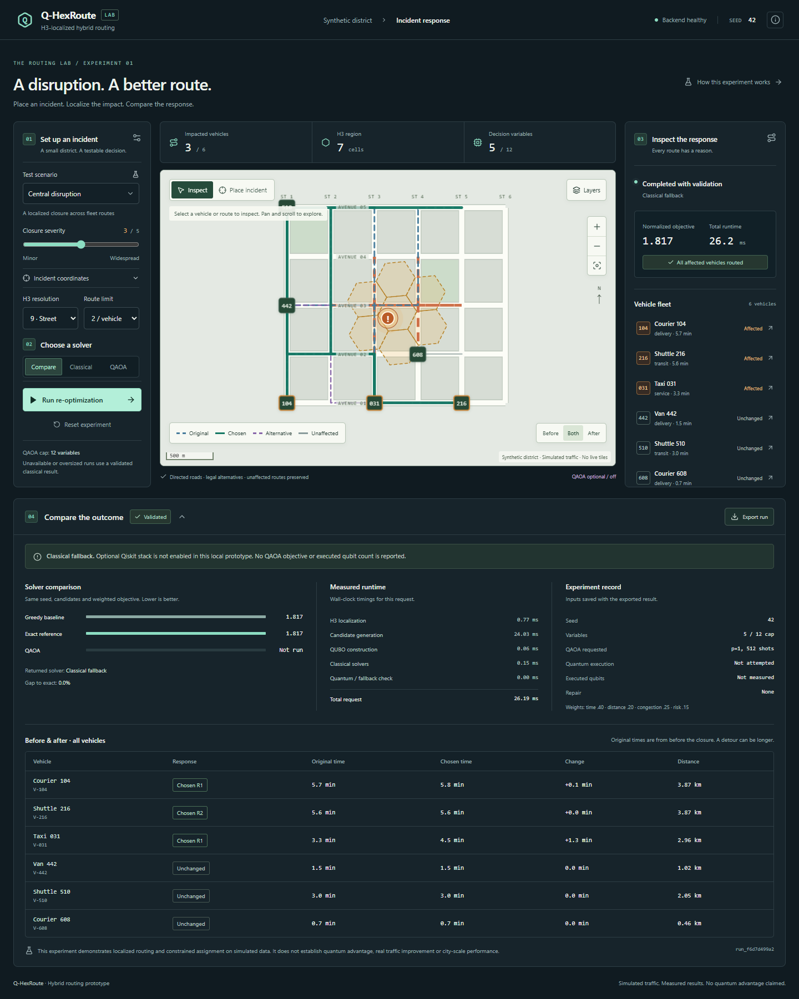
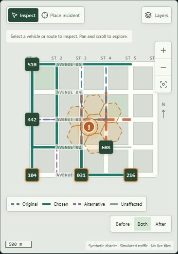

# Q-HexRoute

**Q-HexRoute** is an H3-localized hybrid routing lab for exploring how a road
incident can affect a small fleet and how only the affected vehicles can be
considered for rerouting.

The prototype combines a cached, directed OpenStreetMap driving extract from
central Bengaluru with H3 incident localization, NetworkX route search, an
explainable route-assignment objective, and an optional bounded QAOA path. The
frontend is a React/TypeScript/Vite dashboard with a MapLibre map and visible
OpenStreetMap attribution.

> This is a transparent hackathon prototype, not a live traffic or dispatch
> system. The road geometry and connectivity are real for the bundled extract;
> congestion, incident risk, fleet state, and traffic conditions are simulated.

Repository: <https://github.com/printf-sourav/QhexRoute>



## Contents

- [What the prototype demonstrates](#what-the-prototype-demonstrates)
- [Screenshots](#screenshots)
- [Architecture](#architecture)
- [Quick start](#quick-start)
- [Deploy to Vercel](#deploy-to-vercel)
- [Running the dashboard](#running-the-dashboard)
- [API](#api)
- [Configuration](#configuration)
- [Refreshing the OSM fixture](#refreshing-the-osm-fixture)
- [Optional QAOA execution](#optional-qaoa-execution)
- [Verification](#verification)
- [Repository layout](#repository-layout)
- [Real versus simulated behavior](#real-versus-simulated-behavior)
- [Troubleshooting](#troubleshooting)
- [Data attribution and limitations](#data-attribution-and-limitations)

## What the prototype demonstrates

The default experiment uses a deterministic seed (`42`) and a bounded central
Bengaluru study area. The default incident is near `12.9716, 77.5946` with
severity `3`.

### Real road geometry and directed routing

- `data/demo/roads.graphml` is a checked-in OSMnx GraphML driving extract.
- Directed one-way connectivity is preserved when the fixture is normalized
  into NetworkX.
- OSM edge geometries are oriented from their source node to their target node
  and joined into continuous route `LineString` geometries.
- NetworkX computes current routes and legal alternatives over the road graph.
- A synthetic graph remains available as an explicit fallback when the fixture
  is missing or `QHEXROUTE_USE_OSM_GRAPH=0`.

### H3-localized incident analysis

- H3 cells localize the incident at the selected resolution.
- The complete road geometry is checked for proximity to the incident, not only
  the endpoints of a long edge.
- Route H3 coverage is generated from route geometries. Candidate cells are
  filtered with exact Shapely line/polygon intersection checks.
- The city-scale H3 envelope is contextual; the routing graph is intentionally
  smaller and bounded.

### Explainable constrained assignment

- Affected vehicles are identified before optimization.
- Closed edges are removed from the legal candidate graph.
- Candidate routes are generated with `networkx.shortest_simple_paths`.
- Pareto-dominated candidates are removed.
- Greedy and exhaustive exact solutions provide classical references.
- The QUBO exposes route variables, linear coefficients, overlap terms, and a
  constraint penalty.
- Optional QAOA is capped at 12 binary variables and every returned assignment
  is validated before it can be used.

### Interactive map workflow

The dashboard supports:

1. Choosing a preset incident or entering coordinates.
2. Previewing impacted H3 cells, OSM edges, and vehicles.
3. Running the route comparison.
4. Inspecting vehicle markers, original routes, chosen routes, and alternatives.
5. Toggling the OSM basemap, route H3 cells, incident H3 cells, alternatives,
   closures, and the diagnostic OSM routing graph.
6. Comparing **Before**, **Both**, and **After** route views.
7. Exporting the complete run response and experiment settings as JSON.

The dense OSM routing graph is deliberately **off by default** in the map
layer panel. It is a diagnostic layer containing thousands of edges; enabling
it is useful for inspection but can visually dominate the basemap.

## Screenshots

### Ready state


### Optimization result



### Mobile layout



## Architecture

```text
┌──────────────────────────────┐
│ React + TypeScript + Vite    │  http://127.0.0.1:4321
│ Dashboard / MapLibre / H3 UI │
└───────────────┬──────────────┘
                │ same-origin /api proxy in Vite
┌───────────────▼──────────────┐
│ FastAPI service              │  http://127.0.0.1:8000
│ Scenario / preview / solve  │
└───────┬───────────┬──────────┘
        │           │
   GraphML      H3 + Shapely
   OSM graph   geometry checks
        │           │
        └─────┬─────┘
              ▼
        NetworkX routing
        + classical solvers
        + optional QAOA
```

### Frontend responsibilities

`frontend/src/components/Dashboard.tsx` owns settings, incident state, API
requests, preview cancellation, run invalidation, and JSON export.

`frontend/src/components/RouteMap.tsx` owns the MapLibre instance. It updates
GeoJSON sources in place rather than recreating the map when settings change.
The map has separate inspect and incident-placement modes, route views, layer
controls, route fitting, draggable incident placement, and explicit OSM
attribution.

`SetupPanel`, `Inspector`, and `RunResults` render controls, fleet details,
candidate routes, solver status, timings, and measured objective values.

### Backend responsibilities

`backend/app/main.py` provides the FastAPI application and the deterministic
scenario engine. It:

1. Loads and normalizes the cached directed OSM graph.
2. Assigns seeded simulated edge congestion and dynamic travel times.
3. Snaps the demo fleet anchors to reachable graph nodes.
4. Computes current routes and route-derived H3 coverage.
5. Localizes incidents and identifies affected edges and vehicles.
6. Generates alternatives after removing affected edges.
7. Builds and solves the bounded route-assignment problem.
8. Returns route geometry, H3 GeoJSON, solver metadata, timings, and fallback
   reasons.

`backend/app/graph/osm_refresh.py` and
`backend/scripts/refresh_fixture.py` are explicit developer tools for updating
the cached GraphML fixture. Normal startup does not call Nominatim or Overpass.

## Quick start

### Prerequisites

- Node.js 20 or newer with npm.
- CPython 3.11 or 3.12. Python 3.12 is the recommended local runtime for the
  checked-in environment.
- Internet access for the interactive OpenStreetMap raster basemap.
- Chromium only if you want to run the browser suite.

The checked-in GraphML road fixture means the backend does not need to download
road data during normal startup. No API key is required for the default demo.

### Windows PowerShell

```powershell
git clone https://github.com/printf-sourav/QhexRoute.git
cd QhexRoute

py -3.12 -m venv .venv
.\.venv\Scripts\Activate.ps1

npm install
npm run setup
npm run dev
```

Open <http://127.0.0.1:4321/>.

If PowerShell blocks script activation, either run the commands from a shell
where the virtual environment is already active or use the Python executable
directly. The project launcher also accepts an explicit interpreter:

```powershell
$env:QHEXROUTE_PYTHON = "C:\path\to\python.exe"
npm run dev:backend
```

### macOS or Linux

```bash
git clone https://github.com/printf-sourav/QhexRoute.git
cd QhexRoute

python3.12 -m venv .venv
source .venv/bin/activate

npm install
npm run setup
npm run dev
```

Open <http://127.0.0.1:4321/>.

`npm run setup` installs the backend requirements and frontend dependencies.
The helper at `scripts/python-run.mjs` prefers `QHEXROUTE_PYTHON`, then the
project `.venv`, then a system Python executable.

### Start the services separately

Use two terminals when you want independent logs or need to restart one side:

```bash
# Terminal 1
npm run dev:backend

# Terminal 2
npm run dev:frontend
```

The Vite development server proxies `/api` requests to the FastAPI service.

## Deploy to Vercel

The repository includes a Vercel Services configuration that deploys the two
parts of Q-HexRoute together under one Vercel project and one domain:

- the `frontend` service builds the Vite application and serves static assets;
- the `backend` service runs the FastAPI application as a Python service; and
- `/api/*` is routed to FastAPI while all other paths are routed to the Vite
  frontend.

This is configured in [`vercel.json`](vercel.json). The backend service includes
the checked-in `data/demo/roads.graphml` fixture in its function bundle, so
production requests use the same bounded OSM graph as local requests.

### Deploy from the Vercel dashboard

1. Sign in to Vercel.
2. Select **Add New → Project**.
3. Import `printf-sourav/QhexRoute` from GitHub.
4. Keep the repository root as the project root. Do not set `frontend/` as the
   project root; the root `vercel.json` defines both services.
5. Deploy the project.

Every push to `main` can then create a new production deployment, depending on
the Git integration settings.

### Deploy with the Vercel CLI

Install or run the CLI, authenticate once, and deploy from the repository root:

```bash
npm install -g vercel
vercel login
vercel link
vercel --prod
```

For a non-interactive CI deployment, use a Vercel token supplied through the CI
secret store rather than committing it:

```bash
vercel --token "$VERCEL_TOKEN" --prod
```

Do not put `VERCEL_TOKEN` in `.env.example`, source files, git history, or build
logs.

### Vercel environment variables

The default production configuration works without application secrets. Add
these variables in **Project Settings → Environment Variables** only when you
want to override the defaults:

| Variable | Suggested production value | Scope |
| --- | --- | --- |
| `QHEXROUTE_USE_OSM_GRAPH` | `1` | Backend / Production, Preview, Development as needed |
| `QHEXROUTE_ENABLE_QAOA` | `0` | Backend; keep off unless optional Qiskit dependencies are deliberately added |
| `QHEXROUTE_QAOA_VARIABLE_CAP` | `12` | Backend |
| `QHEXROUTE_QAOA_TIMEOUT_SECONDS` | `15` | Backend |
| `VITE_OSM_TILE_URL` | `https://tile.openstreetmap.org/{z}/{x}/{y}.png` | Frontend build |

`VITE_API_BASE` should remain empty for the combined deployment because the
frontend calls the same-domain `/api` routes. If the backend is deployed as a
separate project, set `VITE_API_BASE` to that backend's HTTPS URL and redeploy
the frontend.

### Production smoke checks

After Vercel reports the deployment as ready, replace `<deployment-url>` with
the generated HTTPS URL:

```bash
curl https://<deployment-url>/api/health
curl 'https://<deployment-url>/api/scenario?seed=42'
```

The health response should report `status: "ok"`. The scenario response should
report `graph_source: "openstreetmap"` when the bundled fixture loaded
successfully. Open the root URL in a browser and verify that the map keeps the
visible OpenStreetMap attribution and that the **Run re-optimization** flow
completes.

### Vercel deployment notes

- Vercel Functions are stateless between invocations; completed runs in
  `/api/runs/{run_id}` are held in memory and are not durable storage.
- The optional QAOA path is not part of the default production dependency set.
- The OSM raster basemap still requires outbound browser access to the tile
  provider and must follow the [OSM tile usage policy](https://operations.osmfoundation.org/policies/tiles/).
- The backend's maximum function duration is configured for 60 seconds in
  `vercel.json`; the available limit still depends on the Vercel plan.

## Running the dashboard

1. Open the dashboard. The initial map fits the bounded OSM routing area.
2. Choose one of the test scenarios:
   - **Central disruption** — the default incident near central Bengaluru.
   - **East junction** — a second impact location for comparison.
   - **Quiet corner** — a no-change case where no current route is affected.
   - **District closure** — a stress case that can produce a partial result.
3. Adjust severity, H3 resolution, candidate count, solver mode, or seed.
4. Press **Run re-optimization**.
5. Select a fleet row or map marker to inspect the original route and candidate
   routes.
6. Use **Before**, **Both**, and **After** to compare route geometry.
7. Open **Layers** to toggle overlays. Leave **OSM routing graph** off unless
   you want to inspect the entire diagnostic graph.
8. Use **Place incident** to click on the map or drag the amber marker. The
   coordinate panel supports keyboard entry.
9. Use **Export run** to download a JSON record containing the incident,
   candidates, selected routes, QUBO data, timings, and solver metadata.

The default result intentionally reports a classical fallback when QAOA is not
enabled. That is a valid result, not a silent failure.

## API

The backend listens on `http://127.0.0.1:8000` by default.

### `GET /api/health`

Reports service readiness and whether the optional Qiskit path is enabled.

```json
{
  "status": "ok",
  "graph_ready": true,
  "qiskit_ready": false,
  "app_version": "0.1.0"
}
```

### `GET /api/scenario?seed=42`

Returns the seeded scenario, road-network GeoJSON, fleet routes, city bounds,
routing bounds, route H3 coverage, and graph source.

Important response fields include:

- `graph_source`: `openstreetmap` or `synthetic`.
- `road_network`: directed road-edge `FeatureCollection`.
- `vehicles`: the six demo vehicles and their current routes.
- `route_h3_coverage`: H3 cells intersected by the visible route geometries.
- `h3_coverage`: coarser Bengaluru context coverage.
- `routing_bounds`: the bounds of the actual loaded routing extract.

### `POST /api/incidents/preview`

Previews the localized impact without running optimization.

```json
{
  "latitude": 12.9716,
  "longitude": 77.5946,
  "severity": 3,
  "seed": 42,
  "h3_resolution": 9
}
```

The response includes affected H3 cells, affected edge IDs, affected vehicle
IDs, edge count, and the variable reduction estimate.

### `POST /api/optimize`

Runs candidate generation and the selected solver mode.

```json
{
  "incident": {
    "latitude": 12.9716,
    "longitude": 77.5946,
    "severity": 3
  },
  "h3_resolution": 9,
  "candidate_count": 2,
  "qaoa_depth": 1,
  "shots": 512,
  "seed": 42,
  "solver_mode": "compare"
}
```

Possible result states are:

- `success` — every affected vehicle received a legal selected route.
- `partial` — at least one affected vehicle has no legal alternative.
- `no_change` — no current route is affected, so no assignment is needed.

The response includes selected, candidate, original, and unaffected route
GeoJSON; objective components; greedy/exact/QAOA comparison values; QUBO
metadata; timings; and explicit fallback information.

### `GET /api/runs/{run_id}`

Retrieves a completed run from the backend's in-memory run store. Runs are not
persisted across backend restarts.

### Example requests

PowerShell:

```powershell
Invoke-RestMethod http://127.0.0.1:8000/api/health
Invoke-RestMethod "http://127.0.0.1:8000/api/scenario?seed=42"
```

Linux/macOS:

```bash
curl http://127.0.0.1:8000/api/health
curl 'http://127.0.0.1:8000/api/scenario?seed=42'
```

## Configuration

Copy `.env.example` values into the environment or into the appropriate local
`.env` file. Do not commit secrets or machine-specific `.env` files.

| Variable | Default | Purpose |
| --- | --- | --- |
| `QHEXROUTE_USE_OSM_GRAPH` | `1` | Load the checked-in OSM graph. Set to `0` to exercise the deterministic synthetic fallback. |
| `QHEXROUTE_ENABLE_QAOA` | `0` | Enable the optional local Qiskit/QAOA path. |
| `QHEXROUTE_QAOA_VARIABLE_CAP` | `12` | Maximum binary variables submitted to QAOA. Values above 12 are clamped. |
| `QHEXROUTE_QAOA_TIMEOUT_SECONDS` | `15` | Server-side timeout for the optional QAOA worker. |
| `VITE_API_BASE` | empty | API base URL when the frontend is not using the Vite `/api` proxy. |
| `VITE_OSM_TILE_URL` | `https://tile.openstreetmap.org/{z}/{x}/{y}.png` | Raster tile template used by MapLibre. |

The seed is supplied through the UI and API requests rather than an environment
variable. Reusing the same seed and inputs reproduces the simulated edge
weights and route metrics.

## Refreshing the OSM fixture

The checked-in fixture is intentionally cached so normal startup does not call
external geocoding or Overpass services. Refreshing it is an explicit action
and requires network access.

Install the optional OSMnx dependency:

```bash
node scripts/python-run.mjs -m pip install -r backend/requirements-osm.txt
```

Refresh the central Bengaluru extract:

```bash
node scripts/python-run.mjs backend/scripts/refresh_fixture.py \
  "Bengaluru, Karnataka, India" \
  data/demo/roads.graphml \
  --dist 2000
```

The refresh helper:

- geocodes the supplied place with OSMnx;
- downloads a simplified directed driving graph;
- truncates it by edge to preserve roads crossing the bounding box;
- records `source=openstreetmap` and `source_place` metadata; and
- writes GraphML to the requested path.

After changing the fixture, rerun the backend and browser checks. Review the
resulting graph size and bounds before committing a substantially larger
extract. The application keeps the route fixture bounded for a responsive demo.

## Optional QAOA execution

The default configuration does not require Qiskit. It runs the classical exact
reference and reports `classical_fallback` when the optional quantum path is not
enabled.

Install the optional packages:

```bash
node scripts/python-run.mjs -m pip install -r backend/requirements-quantum.txt
```

Enable QAOA before starting the backend:

### Windows PowerShell

```powershell
$env:QHEXROUTE_ENABLE_QAOA = "1"
npm run dev:backend
```

### macOS/Linux

```bash
export QHEXROUTE_ENABLE_QAOA=1
npm run dev:backend
```

The safety and reproducibility rules are intentional:

- The hard maximum is 12 binary variables.
- `QHEXROUTE_QAOA_VARIABLE_CAP` can lower the cap but cannot raise it above 12.
- QAOA uses the same seeded candidate instance as the classical solvers.
- The worker has a bounded timeout controlled by
  `QHEXROUTE_QAOA_TIMEOUT_SECONDS`.
- Infeasible, timed-out, unavailable, or invalid quantum results are rejected
  and replaced with the validated classical result.
- The UI and API do not claim quantum advantage or speedup.

## Verification

Run the backend and frontend checks from the repository root:

```bash
# TypeScript typecheck
npm run check

# Production frontend build
npm run build

# Backend unit/API tests
npm test
```

Install Playwright's browser once, then run the end-to-end suite:

```bash
cd frontend
npx playwright install chromium
cd ..
npm run test:browser
```

The browser suite covers:

- OSM basemap loading and visible attribution;
- real comparison and classical fallback messaging;
- route inspection and before/after views;
- route H3 and incident H3 layer toggles;
- explicit incident placement and draggable marker behavior;
- quiet/no-change and partial/unroutable scenarios;
- settings, seeds, reset, and preview invalidation;
- JSON export;
- mobile controls and responsive layout; and
- recovery after a failed optimization request.

The expected local baseline for the current prototype is:

- backend tests: 23 passing;
- frontend typecheck: passing;
- frontend production build: passing; and
- browser tests: 7 passing.

Exact timing and optional QAOA availability depend on the local machine. The
large MapLibre worker bundle warning from Vite is expected for this prototype.

## Repository layout

```text
.
├── backend/
│   ├── app/
│   │   ├── graph/osm_refresh.py  # Explicit OSM fixture refresh helper
│   │   └── main.py               # FastAPI app and routing/optimization engine
│   ├── scripts/refresh_fixture.py
│   ├── requirements.txt
│   ├── requirements-osm.txt
│   ├── requirements-quantum.txt
│   └── tests/test_main.py
├── data/demo/roads.graphml       # Cached directed OSM driving fixture
├── docs/
│   ├── ARCHITECTURE.md
│   ├── DASHBOARD_PLAN.md
│   ├── DASHBOARD_VERIFICATION.md
│   ├── DEMO_SCRIPT.md
│   ├── SCIENTIFIC_LIMITATIONS.md
│   └── screenshots/
├── frontend/
│   ├── src/components/           # Dashboard, map, setup, inspector, results
│   ├── src/styles/global.css
│   ├── tests/dashboard.spec.ts
│   └── playwright.config.ts
├── scripts/python-run.mjs        # Cross-platform Python launcher
├── .env.example                  # Documented local configuration
├── AGENTS.md                     # Project development constraints
├── package.json                  # Root development/test commands
└── README.md
```

Generated dependencies, virtual environments, local environment files, test
reports, caches, session artifacts, and verification screenshots are excluded
by `.gitignore`. The checked-in GraphML fixture and documentation screenshots
are intentional project assets.

## Real versus simulated behavior

### Real or computed from real bundled data

- Directed OSM road geometry and graph connectivity in the cached extract.
- Node snapping and shortest-path route computation over that graph.
- Route geometry serialization and route/H3 intersection coverage.
- Full-edge incident proximity checks.
- H3 incident localization and affected-edge filtering.
- Alternative route generation over a graph with affected edges removed.
- Pareto filtering, normalized objective calculation, QUBO construction, and
  exact/greedy classical solver outputs.
- Feasibility validation, API timings, UI state transitions, and exported run
  metadata.

### Simulated or deliberately bounded

- The six-vehicle fleet and its anchor points.
- Congestion multipliers and dynamic travel-time values.
- Incident risk values.
- Live traffic, road closures, weather, turn restrictions, access rules, and
  emergency dispatch behavior.
- The central Bengaluru graph is a bounded extract, not a complete city-wide
  road or traffic model.
- QAOA is optional local simulation; IBM Quantum hardware is not part of the
  default application.

## Troubleshooting

### The backend cannot start

Check that the selected interpreter is Python 3.11 or 3.12 and that the
requirements were installed into the same environment used to launch Uvicorn:

```bash
node scripts/python-run.mjs -c "import fastapi, h3, shapely, networkx; print('backend dependencies ok')"
```

On Windows, explicitly select a compatible interpreter if another Python is
being found first:

```powershell
$env:QHEXROUTE_PYTHON = "C:\Users\you\AppData\Local\Programs\Python\Python312\python.exe"
npm run dev:backend
```

### The dashboard says the backend is offline

Start the backend on port 8000 and check:

```bash
curl http://127.0.0.1:8000/api/health
```

Then start the frontend on port 4321. If a port is already occupied, stop the
old process or run the services on different ports and update the Vite proxy
configuration accordingly.

### The map is blank or the streets are missing

The basemap uses network-loaded OpenStreetMap raster tiles. Check browser
network access and keep the OSM attribution visible. The routing overlays still
work if the tile service is unavailable.

If the map looks washed out, leave **OSM routing graph** disabled in the Layers
panel. That layer is a dense diagnostic rendering of all cached directed graph
edges; routes and H3 cells are separate, lighter layers.

### The API reports `graph_source: synthetic`

The OSM fixture was not loaded or `QHEXROUTE_USE_OSM_GRAPH=0` is set. Confirm
that `data/demo/roads.graphml` exists, install the regular backend requirements,
and restart the service. The synthetic fallback is intentional and is labeled
in the UI; it is not silently presented as OSM data.

### Browser tests fail because Chromium is missing

Install the browser from the `frontend` directory:

```bash
cd frontend
npx playwright install chromium
```

Then run `npm run test:browser` from the repository root.

## Data attribution and limitations

The map displays OpenStreetMap tiles and the backend uses a cached OSM-derived
driving graph. Keep the visible attribution in place and follow the
[OpenStreetMap tile usage policy](https://operations.osmfoundation.org/policies/tiles/).
For OpenStreetMap attribution and licensing information, see
<https://www.openstreetmap.org/copyright>.

The cached extract can become stale and should be refreshed explicitly when a
new graph is needed. The project does not claim live coverage, live traffic,
production routing quality, reduced congestion, quantum speedup, or quantum
advantage. See the detailed notes in:

- [`docs/ARCHITECTURE.md`](docs/ARCHITECTURE.md)
- [`docs/DEMO_SCRIPT.md`](docs/DEMO_SCRIPT.md)
- [`docs/DASHBOARD_VERIFICATION.md`](docs/DASHBOARD_VERIFICATION.md)
- [`docs/SCIENTIFIC_LIMITATIONS.md`](docs/SCIENTIFIC_LIMITATIONS.md)

There is currently no separate project license file. Add an appropriate license
before distributing the source beyond the repository, and preserve the
applicable terms for the bundled OSM-derived data.
